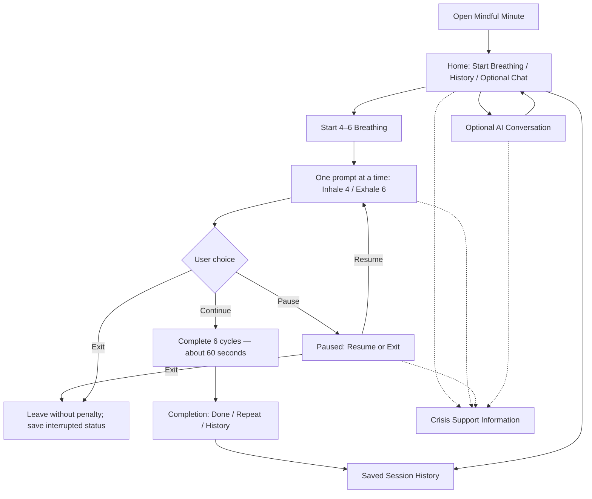

# Assignment 3.1 — Research and Design

**Course:** IST 402  
**Project:** Mindful Minute — Guided Meditation Skills Application  
**Milestone:** Part 1 — Research and Design  
**Submission date:** October 15, 2026

## 1. Submission Links and Current Status

- **GitHub repository:** [ADD REPOSITORY URL]
- **Submitted commit:** [ADD EXACT COMMIT HASH OR LINK]
- **Design document(s):** [ADD LINK(S), IF STORED SEPARATELY]
- **Design sketch / flow diagram:** Included in Section 4 below; [ADD REPOSITORY LINK IF APPLICABLE]
- **Evidence log:** [ADD LINK TO REDACTED EVIDENCE LOG]
- **Recording:** Not required as a working-app demonstration for Part 1; [ADD LINK IF YOU CREATED A DESIGN WALKTHROUGH]

**Completed at the design stage:** Proposed the app's core skill, interface flow, technology architecture, data model, model responsibilities, safety design, and research-based design rationale. This report describes the proposed design; it does **not** claim that the application, repository, or features have been implemented or verified.

**Not yet complete:** Implementation, browser verification, SQLite persistence tests, model integration, and measured end-to-end exercise timing. Repository and evidence links must be completed before submission.

## 2. Project Overview and Scope

My proposed application is **Mindful Minute**, a simple, meditation-style application designed around a short, guided breathing exercise. A user can choose to begin a paced-breathing session, follow clear visual and written prompts, pause or exit whenever they want, and later review previous sessions. The app will be a **coursework skills prototype**, not a therapy service, diagnostic tool, or substitute for professional or emergency help. All development tests and demonstrations will use fictional scenarios.

I chose meditation because a short breathing exercise can be presented with very little reading or typing. Rather than trying to build a large library of meditations, my first version will focus on the research-listed **4–6 paced breathing skill**: inhale for four counts and exhale for six counts, repeating for approximately 60 seconds. I will keep that sequence fixed so the application does not invent or change the skill's instructions. Other exercises, such as 5-4-3-2-1 grounding, are possible future additions but are not part of my committed Part 1 scope.

The main goal is to let a user start a short exercise without navigating through complicated menus, entering sensitive personal information, or feeling pressured to finish.

## 3. Research Foundation and Design Decisions

The assignment's research summary reports feedback from 15 patients, 13 clinicians, and 15 prototype evaluation sessions, with 150 coded participant–task combinations. The counts describe mentions and observed behavior; they do **not** prove that the proposed application is clinically effective.

| Finding | Research observation | Decision for Mindful Minute |
|---|---|---|
| **R1 — Short exercises** | Around 60 seconds felt comfortable; attention dropped beyond 90–100 seconds. | Make the guided breathing sequence 60 seconds: six cycles of four-count inhalation and six-count exhalation. |
| **R2 — Frictionless crisis access** | Participants wanted safety information without searching through screens. | Show a clearly labeled **Crisis Support** control from the home screen and every exercise screen. |
| **R3 — Permission to stop** | Participants wanted to leave without consequences. | Provide **Pause** and **Exit** throughout the exercise; do not shame users or require a reason to leave. |
| **R4 — User control** | Participants preferred options rather than forced routing. | Let users choose when to start, pause, resume, exit, or repeat the exercise; AI suggestions are optional. |
| **D1 — Progressive interface contraction** | Participants preferred fewer demands when distressed, but the study did not establish a distress detector. | Keep the exercise screen minimal by default; do not claim to detect distress automatically. |
| **D2 — One atomic skill at a time** | One action per screen was preferred. | Show one instruction at a time: either **Breathe in** or **Breathe out**. |
| **D3 — Minimize emotional cost** | Participants disliked being required to disclose or perform emotionally demanding tasks. | No mandatory mood score, journaling, personal story, or typed response before beginning. |
| **D4 — Persistently visible safety** | Safety access needed to remain visible during an exercise. | Keep the Crisis Support control visible even if the chatbot or backend fails. |
| **D5 — Personalization without setup burden** | Participants wanted useful adaptation without extensive configuration. | Offer **Repeat last exercise** when history exists; allow users to ignore it. |
| **D6 — Low-stimulus language** | Clinical or overly cheerful wording and intense motion could add pressure. | Use neutral wording, muted colors, and gentle optional visual pacing; avoid diagnosis and exaggerated encouragement. |

### Tradeoffs

The design intentionally sacrifices variety to reduce complexity and make the core experience more dependable. Saving the most recent exercise may make returning easier, but it must not automatically start a session or take away the user's choice. A simple interface is also less customizable; I will prioritize a visible pause control and a low-motion option over additional visual effects. The research does not establish a reliable way to infer someone's distress level, so the app will not use a hidden classifier to change its interface.

## 4. Proposed User Experience

**Home screen:** A clear title, short explanation, **Start Breathing** button, optional **Repeat Last Exercise** and **History** controls, and an always-visible **Crisis Support** link. Optional chat is available but not required to begin.

**Exercise screen:** A large breathing cue, one instruction at a time, and visible **Pause**, **Exit**, and **Crisis Support** controls. A gently expanding and contracting circle can accompany the fixed four-second inhale and six-second exhale; a static text/countdown alternative will be available if motion is distracting.

**Completion screen:** A neutral message such as “Exercise finished,” with choices to return home, repeat, or view history. The app will not claim that the user feels better.

**History screen:** A short list showing session date, skill, and whether it was completed or interrupted. Selecting a record shows the duration and status without requiring the user to review sensitive chat text.

**Empty and failure states:** If there are no sessions, show “No sessions yet” with a Start button. If a model request fails, show “The chat is unavailable right now” and keep the guided breathing, Exit, and Crisis Support controls accessible. If saving fails, tell the user the session could not be saved instead of claiming success.

## 5. Technical Architecture

I plan to reuse the **Vue frontend, FastAPI backend, and SQLite database** pattern from my previous travel application and chatbot work, adapting it for a different user experience.

| Component | Planned responsibility |
|---|---|
| **Vue frontend** | Display the home page, breathing cues, pause/exit controls, optional chat, crisis-support route, and history. Control the fixed visual breathing timer. |
| **FastAPI backend** | Provide endpoints to create and update sessions, retrieve history, and handle optional model requests. Validate incoming data. |
| **SQLite database** | Persist session and conversation records across page refreshes and application restarts. |
| **Conversational model** | Provide brief, non-diagnostic explanations or offer a choice to start the fixed breathing exercise; not control the exercise sequence. |
| **JSON over HTTP** | Carry requests and responses between Vue and FastAPI. |

**Proposed API routes:** `POST /api/sessions` (start session), `PATCH /api/sessions/{id}` (save completion or interruption), `GET /api/sessions` (history), `GET /api/sessions/{id}` (details), and `POST /api/chat` (optional conversation). These are planned interfaces, not verified endpoints.

**Proposed data:** A `sessions` table with session ID, skill name, start time, end time, elapsed guided seconds, and status (`completed` or `interrupted`). A `conversations` table and `messages` table would store optional chat history, including role, content, timestamp, and conversation ID. For personalization, the latest completed skill can be derived from session history instead of asking users to configure a profile. I will avoid collecting real names, diagnoses, or personal health information. A local development database will use only fictional records.

## 6. AI Role and Safety Boundaries

The chatbot is **optional**. It can answer simple questions about what the app does and invite a user to try the predefined breathing exercise. It should use a short, neutral tone and relevant application context, such as which skill is available. The model must not invent new therapy exercises, diagnose a user, claim to be a therapist, or claim that a person is monitoring the conversation.

The breathing steps, timing, session status, storage operations, exit behavior, and crisis-support route will be implemented in application code, **not left to the model's prompt**. This keeps the core skill usable if the model returns an unexpected response or fails entirely.

**Crisis support:** A persistent, clearly labeled control will open a static support-information view independent of model calls. For a U.S.-focused prototype, that view can identify 988 as a crisis-support option and emergency services for immediate danger, while clearly stating the app is not monitored and is not an emergency service. The app will not rely on keyword detection to reveal this route. If crisis-related text appears in the optional chat, the design should avoid continuing ordinary skill suggestions as though nothing happened and instead direct attention to the independently available support information. This response will be tested with fictional inputs only.

**Privacy and testing:** Use synthetic identities and fictional scenarios, avoid exposing API keys, and keep credentials out of GitHub. No testing will involve a real person in distress. The prototype will not be publicly deployed or recommended for real mental health support.

## 7. Exercise Timing and Verification Plan

The planned exercise is **six cycles** of four seconds inhaling and six seconds exhaling, for **60 seconds** of guided instructions. The clock starts with the first “Breathe in” cue and ends after the final “Breathe out” cue. The target assumes the user does not pause and that the fixed frontend transitions add negligible delay; actual elapsed time must be measured in the working browser in Part 2. Entry and setup time will be measured separately. A user-chosen pause will not force the exercise to end.

In Part 2, I plan to check that a normal uninterrupted run takes no more than 90 seconds, that Exit works mid-exercise, that saved history survives refresh/restart, and that Crisis Support remains available when a simulated model request fails. I will distinguish mocked responses from live-model tests.

## 8. Reuse, Process, and Evidence

I plan to reuse architectural patterns learned in Assignments 1 and 2: Vue components for interface screens, FastAPI routes for backend behavior, SQLite persistence, and an optional chatbot workflow. I will identify any code actually copied or adapted once implementation begins. The meditation content, interface flow, safety controls, and research rationale are new design decisions for Assignment 3.

**AI assistance disclosure:** ChatGPT (OpenAI; GPT-6) assisted with organizing and drafting this Part 1 research-and-design report based on the assignment requirements and my selected meditation concept. I am responsible for reviewing and revising the design, checking the repository, and verifying later implementation. [ADD ANY OTHER AI TOOLS/MODELS USED.] Major prompts and decisions should be summarized in a redacted repository evidence log rather than submitting a full private conversation.

**Repository checkpoint:** [DESCRIBE WHAT IS ACTUALLY COMMITTED AND REVIEWED, AFTER CREATING THE COMMIT.]  
**Evidence of manual review:** [ADD WHAT YOU PERSONALLY CHECKED, WITH A LINK IF AVAILABLE.]  
**Revised/failed approach:** [ADD A REAL EXAMPLE IF ONE OCCURS; DO NOT INVENT A TEST FAILURE.]

## 9. Open Questions and Next Steps

I still need to determine whether the pacing cue is clearest as a changing circle, a countdown, or both; test the low-motion alternative; decide how much chat history should be displayed; and verify that the session timer and persistence work reliably. I also need to check how the optional model behaves with ambiguous or crisis-related fictional inputs without depending on the model for access to safety information.

For Part 2, I will implement the fixed breathing flow first, connect session records to SQLite, add the history screen and independent crisis-support route, and then integrate the optional conversational model. I will test the application in the browser and inspect database records before describing any behavior as verified.

---

**Submission reminder:** Before uploading this file, replace every bracketed placeholder with a real link or accurate status, commit the relevant project files, and confirm the GitHub links are accessible to the instructor.
